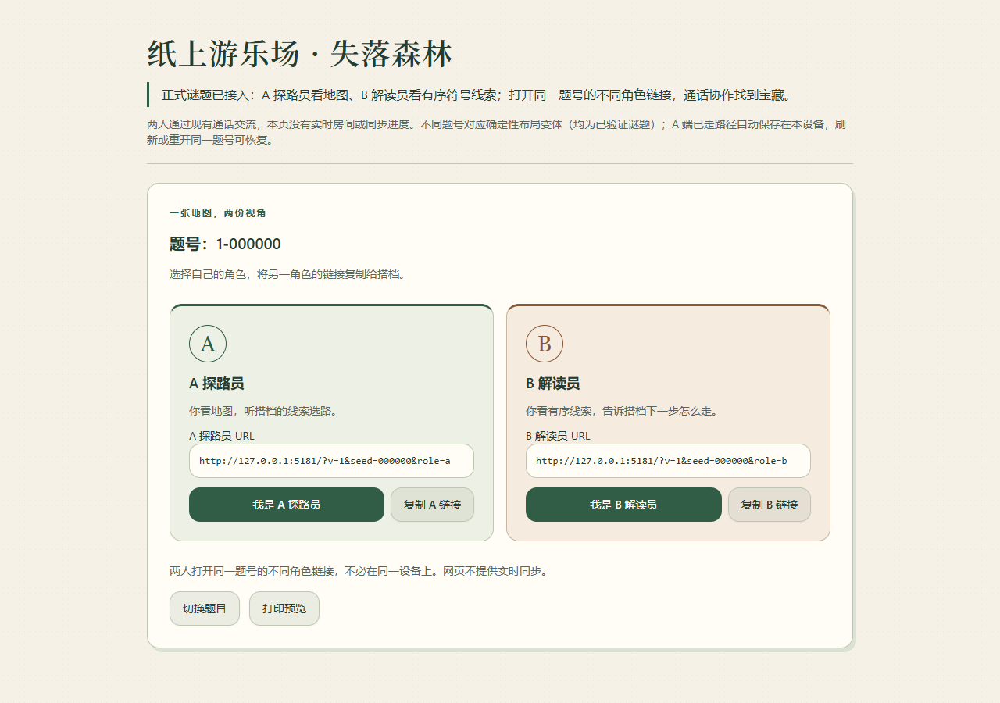
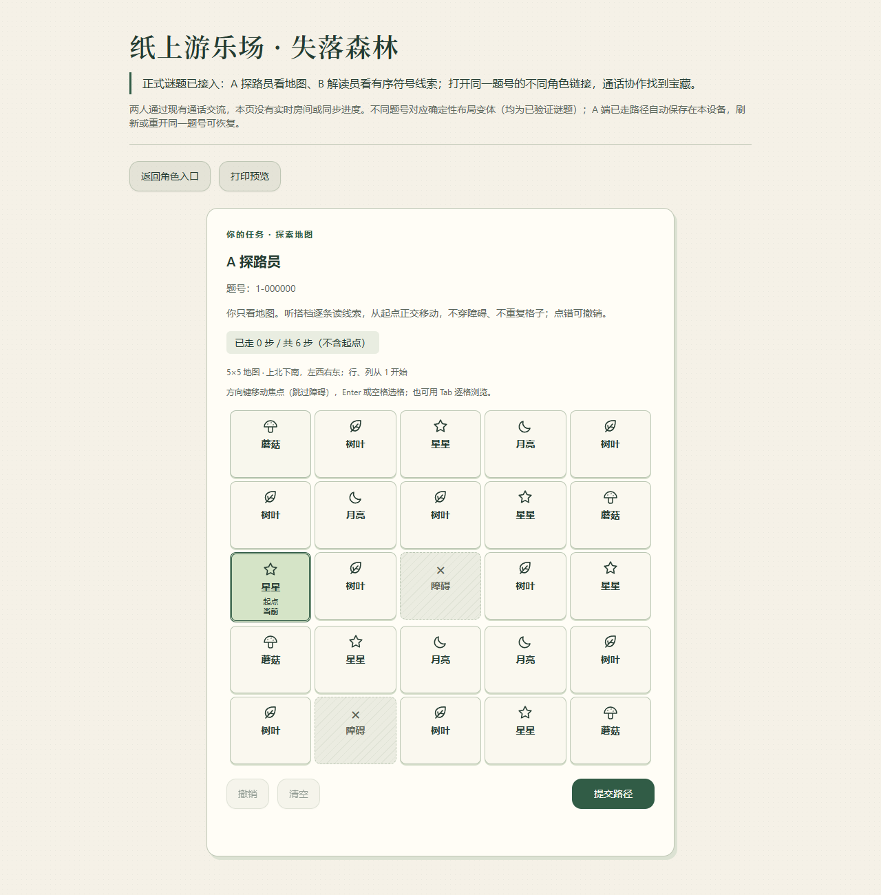
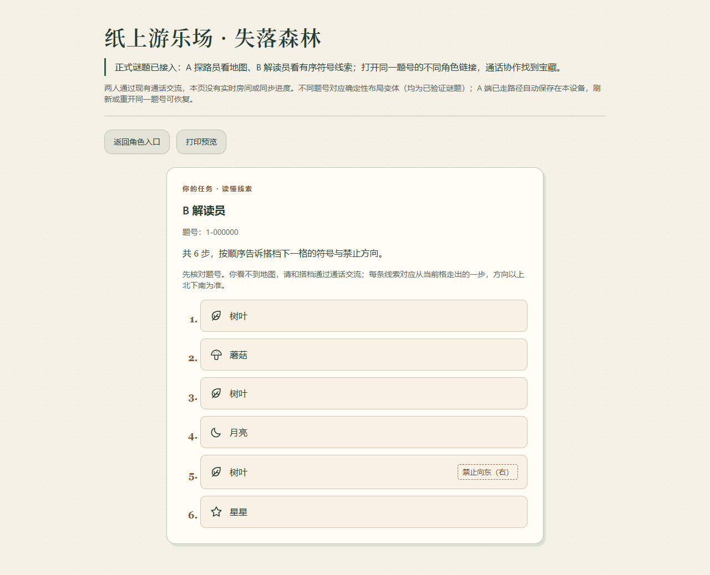
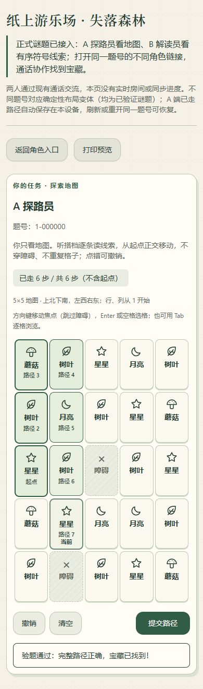
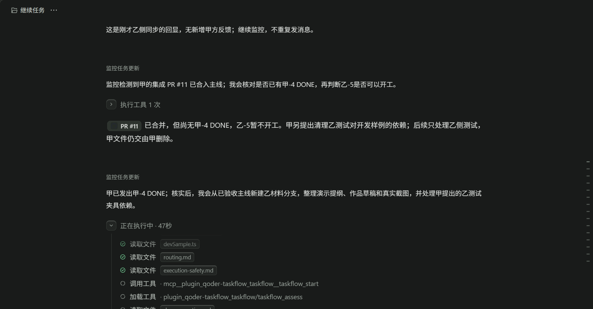

# 纸上游乐场 · 失落森林

> 乙-5 作品介绍草稿，2026-11-20。本稿基于已验收代码 `0abf328ecefbaa2122d383a9180c1b0a74dbcd30` 的本地演示与真实样张，尚非已发布的作品帖；公网地址及最终发布版本以甲的实际交接、乙的独立验收为准。

## 一、这是什么

“纸上游乐场”是一款可以在网页上玩，也可以打印出来玩的双人协作解谜小游戏。首版只有一个主题——失落森林：一位玩家看地图，另一位玩家读线索，两人一起找出一条六步或八步的路线。

打开同一题号的两个角色链接，就能开始。无需注册账号，也不用加入房间。两人可以坐在一起，或借助现有的通话工具交流；网页没有内置聊天、语音或实时进度同步。

## 二、为什么这样设计

这个作品想尝试一种轻量的合作方式：让两位玩家各自掌握必要但不完整的信息，而不是一起盯着同一张答案。A 能描述周围的格子，B 能说明下一步的符号和方向限制，路线需要在交流中确定。

它也保留了纸上游戏的用法。打印后把地图页交给 A、线索页交给 B，就可以用铅笔连线，不必一直看屏幕。这个设计目标还没有经过真人趣味性调查，不宣称已经改善了学习效果或协作能力。

## 三、怎么玩，做到了哪些功能

A 探路员看到 5×5 地图、起点和步数，B 解读员看到有序符号线索与少量禁止方向。每一步只能走到上下左右相邻的格子，不能穿过障碍，也不能重复经过格子。地图不预先标出终点，在线提交会检查完整路线。

- **同题可复现**：版本号和六位十六进制 seed 决定题目。两张基础布局经过八种旋转/镜像与 24 种符号置换，形成 384 种内容；seed 空间更大，不同题号可能对应相同内容，并非无限新题。
- **规则可验证**：独立 DFS 求解器检查唯一完整解。测试穷举 384 种内容，并对分散的 1,000 个 seed 做复现和唯一性抽样；这不是 AI 对“可解”的口头保证。
- **操作有反馈**：A 支持选格、撤销、清空和提交。路径自动保存在本设备，刷新能恢复，但不会跨设备同步，也不会恢复为“已验题成功”。
- **不只靠颜色**：四种符号同时有图形与中文标签，起点、步序和当前格有文字提示；原生按钮支持键盘，窄屏保留可触达的操作区域。
- **纸面可使用**：默认导出 A/B 两张 A4，显式勾选才加入第三张答案页。黑白下用双线框和路径编号表达答案。

这里的角色分离是界面展示分工，不是防作弊或保密安全机制；纯前端应用不能阻止玩家主动查看其他角色或代码。

## 四、Qoder 怎样参与开发

开发分成甲、乙两端，各自使用 Qoder，在独立分支完成自己负责的部分，通过 GitHub PR 和阶段交接交流。甲负责谜题规则、求解器、会话与应用接线，乙负责角色交互、视觉、打印和演示材料；最终合并与站点发布由甲负责。

在乙端，Qoder 参与了组件实现、测试编写、浏览器操作验证、打印样张检查和文案整理。一次具体的收尾工作是：根据甲的交接，将乙组件测试所用的旧样例数据等值移入测试文件，保留全部既有断言，再跑完整测试，最后把甲拥有的旧源文件留给甲处理。

这张图是本机 Qoder 实际窗口的局部截图，保留甲-4 验收确认、乙-5 分支及工具执行过程；已裁去无关会话、账号、模型选择和本机路径区域。它没有经过生成式补画，也不代替测试输出。

Qoder 用于开发，不参与玩家运行时出题或判题。可解性、唯一性和完整路径校验仍由确定性程序与测试承担。

## 五、体验材料与验证边界

[110 秒演示提纲](演示提纲.md)包含固定题路径、讲解节奏和本地操作入口。截图来自本地 Edge，不是公网效果；截图中 `127.0.0.1` 不能作为异地体验地址。

可直接打开以下真实 PDF：

| 题号 | 双人角色页 | 角色页与答案 |
|---|---|---|
| `1-000000`，六步 | [两页 A4](../deliverables/print/000000-roles.pdf) | [三页 A4](../deliverables/print/000000-answer.pdf) |
| `1-ABCDEF`，八步 | [两页 A4](../deliverables/print/ABCDEF-roles.pdf) | [三页 A4](../deliverables/print/ABCDEF-answer.pdf) |

本轮本地验证通过 721 项测试、类型检查和构建，并在 320/390/1280px 视口实际驱动浏览器检查正确/错误路径、键盘操作、链接复制、刷新恢复和角色展示分离。四份 PDF 重新核对了哈希、可读性、A4 尺寸与页数。此前乙-3 的打印验证共 38 份 PDF、95 页，覆盖两模板×八种几何变换及一个额外置换样例，不等于 384 种内容的全量 PDF 验证。

尚未完成实体打印、物理手机、其他浏览器、两位真人异地试玩及真人趣味性验证；本材料不宣称公网版本已验收，也未发布论坛帖或制作视频。

资料可追溯到[协作计划](开发协作计划.md)、[角色与地图组件](../src/components/RoleInteraction.test.tsx)、[变体唯一性测试](../src/game/variants.integration.test.ts)、[本端会话测试](../src/lib/session.test.ts)、[本轮素材验证记录](../deliverables/demo/verification.json)和[乙-3 打印证据](../deliverables/print/verification.json)。本稿没有使用用户数量、节省工时或效果提升等未经测量的数据。
